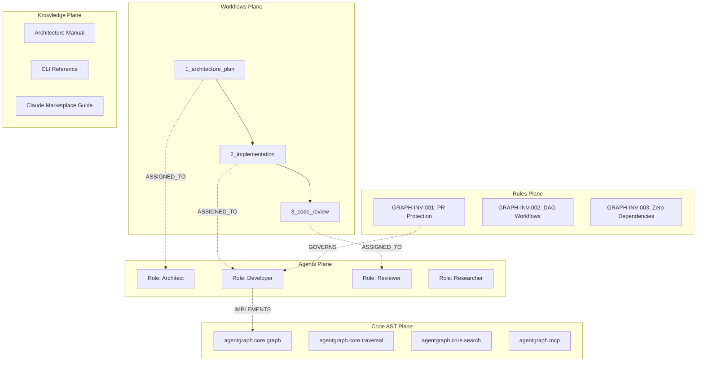

# AGENTS.md — AgentGraph Cognitive Substrate & Architecture Directives

> **Repository:** Bayly-AI/AgentGraph  
> **Framework:** AgentGraph Multi-Plane Engine  
> **Maintainer & Lead Reviewer:** Ray Bayly (@raybayly)  
> **Status:** Active / Open Source  

---

## CR-CLI-ENTRY-001: Start with the CLI (CRITICAL — Org-Wide · CANONICAL)

1. **Start with the CLI (CRITICAL ENTRY GATE)**: When receiving ANY request or starting any task, agents **MUST ALWAYS START WITH THE OPERATOR CLI (`hath0r`)** rather than inventing ad-hoc scripts. Check `hath0r --help` and the matching `hath0r <group> --help` first.
2. **Missing Capability Offer**: If the required connection, MCP, workflow, bot, or factory does not exist in `hath0r`, offer to register the missing capability, using the original request as the acceptance test.
3. **Docs before code**: Require procedure/playbook/runbook before scaffolding implementation.

Canonical: `cr-cli-first-001` in the HATH0R-CLI governance docs (https://github.com/Bayly-AI/HATH0R-CLI, `docs/governance/`).

## 1. System Invariants & Inviolable Directives

### GRAPH-INV-001: Main & Development Branch Protection
This repository is open source and publicly accessible. However, direct pushes to `development`, `master`, `main`, `staging`, or `testing` are restricted exclusively to repository administrators. All proposed modifications must be submitted via Pull Requests against the `development` branch and must receive explicit review and approval by **Ray Bayly (`@raybayly`)** prior to merging.

### GRAPH-INV-002: Acyclic Workflow Execution
All multi-agent pipelines and step dependencies must form a strictly Directed Acyclic Graph (DAG). Topological cycle verification (`agentgraph validate`) must pass cleanly on all PRs.

### GRAPH-INV-003: Zero External Core Dependencies
Core Python engine functionality must not require external pip dependencies beyond the Python 3.9+ standard library.

### GRAPH-INV-004 / CR-CLI-FEATURE-STANDARD-001: CLI-First Shared Features & Artifact Hexad
Anything usable across multiple repos MUST live in `HATH0R-CLI`. Deliver complete feature packages with CLI commands, bots, workflows, and the documentation hexad (Strategy, Procedure, Playbook, Runbook, Workflow, Bot Spec). Member repositories contain declarative configuration files binding to CLI tools.

---

## 2. Multi-Plane Graph Topology

---

## 3. Registered Agent Roles & Responsibilities

| Role ID | Role Name | Primary Objective | Default Tool Authorization |
| :--- | :--- | :--- | :--- |
| `architect` | System & Graph Architect | Designs multi-agent topologies and system boundaries | `view_file`, `agentgraph_query`, `agentgraph_traverse`, `agentgraph_export`, `agentgraph_validate` |
| `developer` | Autonomous Engineer | Implements features, resolves dependency graphs, and generates unit tests | `view_file`, `write_to_file`, `replace_file_content`, `run_command`, `agentgraph_query`, `agentgraph_traverse`, `agentgraph_resolve` |
| `reviewer` | Topology & Code Reviewer | Audits pull requests, verifies graph health, and reviews code | `view_file`, `agentgraph_query`, `agentgraph_validate`, `agentgraph_export` |
| `researcher` | Knowledge & Deep Research | Queries documentation, rules, and code entities | `view_file`, `search_web`, `agentgraph_query`, `agentgraph_traverse` |

---

## 4. Contributing & Pull Request Workflow

1. Fork the repository and create a feature branch (`feat/your-feature`).
2. Run local validation: `python -m agentgraph quality-gate`.
3. Submit a Pull Request targeting `development`.
4. Await review and approval from `@raybayly`.

---

## CR-SONAR-PREANNOUNCE-001 (SonarCloud Thresholds Before Announcing Complete — CANONICAL)
- **Pre-Announcement SonarCloud Gate**: Before announcing any work as Complete, the agent MUST analyze the code and confirm it meets this repository's SonarCloud Quality Gate thresholds (coverage on new code, duplication, reliability, security, maintainability, and security hotspots reviewed).
- **How to Verify**: Use `hath0r quality sonar` (project key from `sonar-project.properties`) together with local test and coverage runs. If the gate cannot be checked, state that plainly instead of announcing Complete.
- **Not Complete Until Green**: A failing or unverified Quality Gate means the work is not Complete.

---

## CR-SEMVER-BUMP-001 (Semantic Version Bump on Every PR — CANONICAL)
- Every pull request that is created and merged must create or bump this product's Semantic Version (`MAJOR.MINOR.PATCH`, https://semver.org). The root `VERSION` file is the source of truth; keep `VERSION`, `pyproject.toml` and `CHANGELOG.md` in step with it.
- Pick the bump by impact: MAJOR for breaking changes, MINOR for backward-compatible features, PATCH for fixes, docs, chores and everything else. `Version Impact: none` is not allowed.
- New products start at `0.1.0`.
- Declare the bump in the PR body as `Version Impact: patch|minor|major` and add a matching `CHANGELOG.md` entry. Verify with `hath0r release validate` before announcing complete.
- A PR merged without a version bump is not Complete.

---

## CR-TASK-EVAL-001 (Automatic Task Evaluation Before Announcing Complete — CRITICAL · CANONICAL)
- **Mandatory Pre-Announcement Task Evaluation Gate**: Every task MUST be evaluated across the 4-tier hybrid evaluation pipeline (Tier 1 Deterministic Rubrics, Tier 2 Trajectory & FinOps Efficiency, Tier 3 Adversarial & Diff Critics, Tier 4 Goal Alignment & Consensus) prior to announcing work as Complete.
- **Composite Reward Threshold**: Task completion requires `passed_gate: true` and composite reward score `R_task >= 0.80` persisted in `.hath0r/evals/latest.json` and compounded as an `eval:<task_id>` node in `.hath0r/memory/graph.json`.
- **How to Verify**: Run `hath0r evals run` and `hath0r evals verify` before announcing Complete (`EndOfTaskBot`, `TaskAnnouncerBot.announce_complete`, and `CleanReposWorkflowBot` enforce this gate automatically).
- **Mandatory Eval Scorecard Summary After Every Task (CRITICAL · CANONICAL)**: Immediately after running task evaluations (`hath0r evals run`), the agent MUST always return a structured summary of the **Eval Scorecard** (`eval_id`, `task_id`, `passed_gate`, composite `R_task`, Tier 1–4 scores, and `.hath0r/evals/latest.json` path) in its completion response to the user.
- **Not Complete Until Evaluated & Scorecard Returned**: A missing, failing, unverified, or unreported task evaluation scorecard means the work is not Complete.

---

## AgentGraph Substrate

This repository is governed by the Hath0r AgentGraph substrate. Dynamic rule retrieval, role RBAC, and policy graphs are stored under `.hath0r/agentgraph/`.
- Query status: `hath0r agentgraph status`
- Query rules: `hath0r agentgraph query "<topic>"`
- Route role: `hath0r agentgraph route --role <role>`
- Sync rules & `CLAUDE.md`: `hath0r agentgraph sync`
- Validate rules: `hath0r agentgraph validate`

---

## CR-CLI-ENTRY-001: Start with the CLI (CRITICAL — Org-Wide · CANONICAL)
- **Start with the CLI (CRITICAL ENTRY GATE)**: When receiving ANY request or starting any task, agents **MUST ALWAYS START WITH THE OPERATOR CLI (`hath0r`)** rather than inventing ad-hoc scripts. Check `hath0r --help` and `hath0r <group> --help` first.
- **Missing Capability Offer**: If the required connection, MCP, workflow, bot, or factory does not exist in `hath0r`, offer to register the missing capability, using the original request as the acceptance test.
- **Docs before code**: Require procedure/playbook/runbook before scaffolding implementation.

---

## CR-CLAUDE-SYNC-001 (Mandatory `CLAUDE.md` ↔ `AGENTS.md` 1:1 Synchronization — CRITICAL · CANONICAL)
- **Exact 1:1 Mirror**: `CLAUDE.md` at the repository root MUST remain an exact byte-for-byte mirror of `AGENTS.md` so all agentic runtimes enforce identical non-conflicting rules.
- **Automated Synchronization**: `hath0r agentgraph sync`, `hath0r memory hash --sync`, and `hath0r clean-repos` automatically synchronize `CLAUDE.md` from `AGENTS.md` and track both files in `.hath0r/memory/hashes.json`.

---

## CR-AGENTIC-SEC-001 (Agentic Security, Supply-Chain & Governance Controls — CRITICAL · CANONICAL)
- **BITE Supply-Chain & Skill Integrity (`hath0r skills audit` / `hath0r mcp audit`)**: Audit all `.agents/skills/**/SKILL.md`, `CLAUDE.md`, `AGENTS.md`, `WARP.md`, and MCP tool schemas for prompt injection, hidden Unicode tag characters, reverse shells, and credential exfiltration, and pin SHA-256 digests in `.hath0r/security/mcp-schema-pins.json`.
- **L2 Output Sanitizer & Dynamic PBAC**: Enforce `L2OutputSanitizer` canary honeytoken verification and `PBACPolicyEngine` (`clearance`, `purpose`, `sensitivity`) across RAG and MCP tool outputs.
- **Cryptographic Hash-Chained Token & Tool Ledger (`hath0r finops tokens verify-ledger`)**: Record and verify tamper-evident SHA-256 hash chains in `.hath0r/state/finops/token_ledger.jsonl`.
- **Fail-Closed `THREATMODEL.md` Gate (`hath0r threatmodel validate`) & Slopsquatting Guard**: Maintain a valid `THREATMODEL.md` in every repository and verify dependency/rule drift (`DependencyGuardBot`) during preflight.

---

## CR-MEMORY-COMPOUND-001 (Mandatory `.hath0r/memory` Repository Presence, Micro Memory Sessions, SHA-256 File Hashing, Un-Ignored Graph Folders & Pre-Announcement MemoryGraph Compounding — CANONICAL)
- **Universal `.hath0r/memory`, `.hath0r/memory/sessions` & `.hath0r/memory/hashes.json` Folder**: Maintain `.hath0r/memory/graph.json`, `.hath0r/memory/sessions/current.json`, `.hath0r/memory/sessions/latest.json`, `.hath0r/memory/hashes.json`, `core_rules.md`, and `architecture.md` (`hath0r memory init` / `hath0r memory ensure-all`).
- **True Micro Memory Session Read & Write**: Every session MUST read and write a compact (<2KB) micro memory session (`hath0r memory session start|read`, `hath0r memory session write`, `hath0r memory session end`).
- **Pre-Announcement Memory Compounding & Hashing**: Compound structured knowledge (`hath0r memory compound`), sync SHA-256 hashes (`hath0r memory hash --sync`), and verify (`hath0r memory verify`) before announcing complete.
